<picture>
  <source media="(prefers-color-scheme: dark)" srcset="./assets/header-dark.svg" />
  
</picture>

<p>
  <a href="https://www.linkedin.com/in/%E0%AE%9A%E0%AE%BE-%E0%AE%9A%E0%AE%A4%E0%AF%80%E0%AE%B7%E0%AF%8D-sathish-saminathan-0a9684124/"></a>
  <a href="https://stackoverflow.com/users/8307090/sathish-saminathan"></a>
  <a href="mailto:sathishcse1975@gmail.com"></a>
</p>

I build interfaces that behave the same way on the web and on a phone, sharing components and state between React and React Native wherever it makes sense. Most of my work lives in that overlap: design systems, form-heavy apps, and the small UI pieces every product needs.

## react-switch-pro

A customizable toggle switch component for React. It's the switch you see flipping on in the banner above.

<p>
  <a href="https://www.npmjs.com/package/react-switch-pro"></a>
  <a href="https://www.npmjs.com/package/react-switch-pro"></a>
  <a href="https://bundlephobia.com/package/react-switch-pro"></a>
  
</p>

```bash
npm install react-switch-pro
```

[Documentation](https://www.npmjs.com/package/react-switch-pro) &nbsp;&nbsp; [Source](https://github.com/SathishSaminathan/react-switch-pro) &nbsp;&nbsp; [Report an issue](https://github.com/SathishSaminathan/react-switch-pro/issues)

## What I work with

| | |
| :-- | :-- |
| **Frameworks** |    |
| **State** |  |
| **Languages** |   |
| **Styling** |   |

## GitHub activity

<picture>
  <source media="(prefers-color-scheme: dark)" srcset="https://github-readme-stats.vercel.app/api?username=SathishSaminathan&show_icons=true&hide_border=true&bg_color=00000000&title_color=61DAFB&icon_color=61DAFB&text_color=C9D1D9" />
  
</picture>
<picture>
  <source media="(prefers-color-scheme: dark)" srcset="https://github-readme-stats.vercel.app/api/top-langs?username=SathishSaminathan&layout=compact&hide_border=true&bg_color=00000000&title_color=61DAFB&text_color=C9D1D9&langs_count=6" />
  
</picture>

<picture>
  <source media="(prefers-color-scheme: dark)" srcset="https://streak-stats.demolab.com?user=SathishSaminathan&hide_border=true&background=00000000&ring=61DAFB&fire=61DAFB&currStreakNum=E6EDF3&sideNums=E6EDF3&currStreakLabel=61DAFB&sideLabels=8B949E&dates=8B949E&stroke=30363D" />
  
</picture>

---

Open to collaborating on React and React Native projects. The quickest way to reach me is on [LinkedIn](https://www.linkedin.com/in/%E0%AE%9A%E0%AE%BE-%E0%AE%9A%E0%AE%A4%E0%AF%80%E0%AE%B7%E0%AF%8D-sathish-saminathan-0a9684124/).
